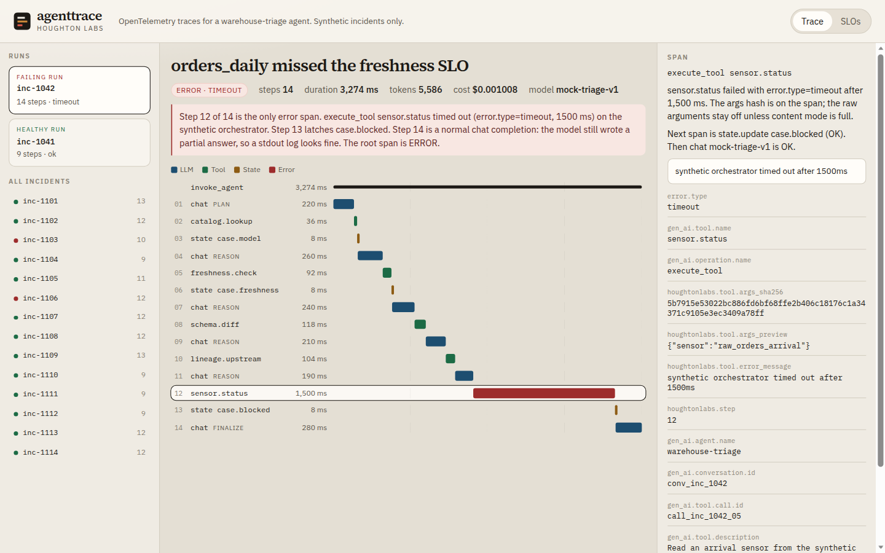
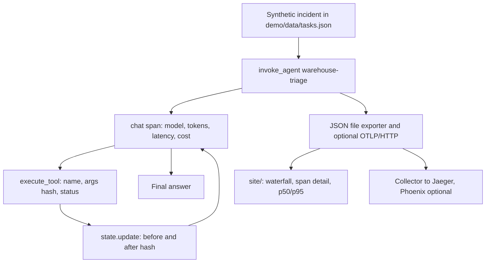
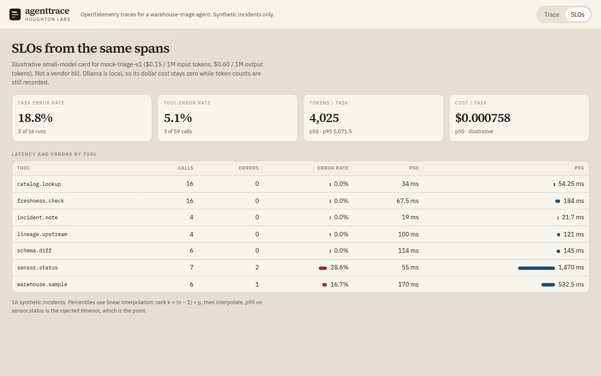
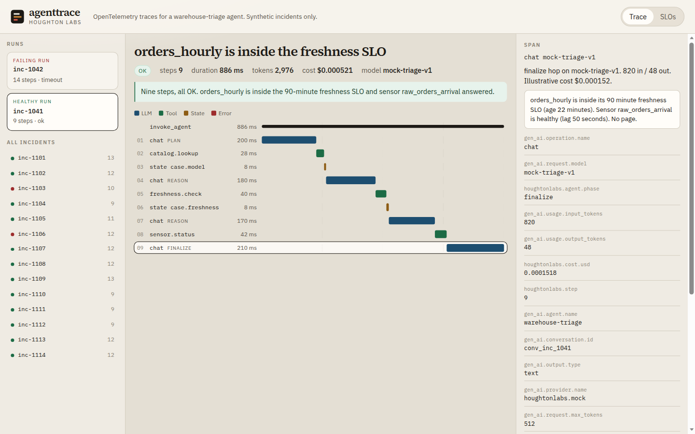

# agenttrace

OpenTelemetry tracing for agent runs: every LLM hop, tool call, token count, latency and state change on one timeline.

The interesting failure is not a missing log line. A 14-step warehouse-triage run still prints a careful final answer. The trace shows the one span that actually failed.



## Why it matters

Production support for an agent is the same job as production support for a pipeline. You want the span that blew the SLO, the tool error rate, and the tokens a task burned. A paragraph from the model is not a status code. This repo runs a small DataOps agent on synthetic incidents and records the run with the [GenAI semantic conventions](https://github.com/open-telemetry/semantic-conventions-genai) where those conventions exist.

## How it works



`warehouse-triage` is a loop, not a one-shot prompt.

1. The planner is the first `chat` span (`houghtonlabs.agent.phase=plan`). It names the next tool.
2. Each tool call is an `execute_tool` span: name, call id, SHA-256 of the canonical arguments, latency, and `error.type` when it fails.
3. A scratchpad write is a `state.update` span with the before and after hashes.
4. Later `chat` spans (`reason`, then `finalize`) read the tool results and either call another tool or stop.

The default provider replays `replay` from the dataset. It does not call a model. Set `HL_LLM_PROVIDER=ollama` and the same loop sends the messages to a local Ollama server instead. Tool results still come from the synthetic fixtures, so a real model cannot see real warehouse data through this repo.

Span names follow the GenAI conventions:

| span | name | kind |
|---|---|---|
| agent | `invoke_agent warehouse-triage` | internal |
| LLM hop | `chat mock-triage-v1` | client |
| tool | `execute_tool sensor.status` | internal |
| scratchpad | `state.update case.blocked` | internal |

`state.update` is an application span. It is not `update_memory`. That convention is for a memory store.

## Quick start

```bash
make install        # venv, OpenTelemetry SDK, pytest
make test           # no API keys, no collector
make run            # replay the dataset, print SLOs, serve http://127.0.0.1:8765
make demo           # regenerate demo/data and site/data from the mock provider
```

`make record` is the same target as `make demo`. The static site replays the JSON in `site/data/`. It has no backend.

Point the dataset somewhere else:

```bash
HL_DATASET_URI=/tmp/tasks.json make run
HL_DATASET_URI=file:///tmp/tasks.json make test
```

Optional collector, Jaeger, and Phoenix:

```bash
docker compose up -d
OTEL_EXPORTER_OTLP_ENDPOINT=http://127.0.0.1:4318 make run
# Jaeger UI: http://127.0.0.1:16686
```

`docker compose --profile phoenix up -d` also starts Phoenix on port 6006. The default collector config only forwards to Jaeger. Mount `deploy/otel-collector-phoenix.yaml` when you want the collector to fan out to Phoenix too. This build speaks OTLP/HTTP (port 4318), not gRPC (port 4317).

Optional local model:

```bash
HL_LLM_PROVIDER=ollama HL_OLLAMA_MODEL=qwen3.5:9b make run
```

| variable | effect |
|---|---|
| `HL_DATASET_URI` | Dataset path or `file://` URI. Default `demo/data/tasks.json`. |
| `HL_LLM_PROVIDER` | `mock` (default) or `ollama`. |
| `HL_OLLAMA_MODEL` | Required when the provider is `ollama`. |
| `OLLAMA_HOST` | Default `http://127.0.0.1:11434`. |
| `HL_TRACE_CONTENT` | `preview` (default), `off`, or `full`. |
| `OTEL_EXPORTER_OTLP_ENDPOINT` | Also export OTLP/HTTP. Unset means JSON only. |
| `OTEL_EXPORTER_OTLP_TRACES_ENDPOINT` | Same, traces-specific. Wins over the generic endpoint. |
| `HL_PORT` | Site port. Default `8765`. Binds to `127.0.0.1`. |

`make record` always uses the mock provider and ignores a live OTLP endpoint, so the committed site does not change because a collector happened to be up.

## The failing run

`inc-1042` is 14 steps under `invoke_agent`. One of them is an error.

| step | span | status | ms |
|---|---|---|---|
| 1 | `chat` plan | OK | 220 |
| 2 | `execute_tool catalog.lookup` | OK | 36 |
| 3 | `state.update case.model` | OK | 8 |
| 4 | `chat` reason | OK | 260 |
| 5 | `execute_tool freshness.check` | OK | 92 |
| 6 | `state.update case.freshness` | OK | 8 |
| 7 | `chat` reason | OK | 240 |
| 8 | `execute_tool schema.diff` | OK | 118 |
| 9 | `chat` reason | OK | 210 |
| 10 | `execute_tool lineage.upstream` | OK | 104 |
| 11 | `chat` reason | OK | 190 |
| 12 | `execute_tool sensor.status` | **ERROR** `timeout` | 1,500 |
| 13 | `state.update case.blocked` | OK | 8 |
| 14 | `chat` finalize | OK | 280 |

The root span is 3,274 ms, status ERROR, `error.type=timeout`. The model still spent 5,208 input tokens and 378 output tokens and wrote a partial answer (illustrative cost $0.001008). Step 14 is a normal completion. A stdout log of that paragraph looks fine. The page is step 12.

`inc-1041` is the healthy pair: 9 steps, all OK, `orders_hourly` inside the SLO. `inc-1108` is the other way around: the schema diff is breaking and the answer says do not retry, but every tool succeeded, so the trace stays OK. Trace status follows the checks, not the verdict.

## Sample metrics

Sixteen synthetic incidents, replayed on the scripted clock. Percentiles are linear: rank `k = (n − 1) × p`, then interpolate. Task error rate is **18.8%** (3/16). Tokens per task are p50 **4,025**, p95 **5,071.5**. Illustrative cost per task is p50 **$0.000758**, p95 **$0.000935**.

| tool | calls | errors | error rate | p50 | p95 |
|---|---:|---:|---:|---:|---:|
| `catalog.lookup` | 16 | 0 | 0% | 34 ms | 54.25 ms |
| `freshness.check` | 16 | 0 | 0% | 67.5 ms | 184 ms |
| `incident.note` | 4 | 0 | 0% | 19 ms | 21.7 ms |
| `lineage.upstream` | 4 | 0 | 0% | 100 ms | 121 ms |
| `schema.diff` | 6 | 0 | 0% | 114 ms | 145 ms |
| `sensor.status` | 7 | 2 | 28.6% | 55 ms | 1,470 ms |
| `warehouse.sample` | 6 | 1 | 16.7% | 170 ms | 532.5 ms |

These are the numbers in `site/data/metrics.json`. `sensor.status` p95 is the injected timeout. That is the shape of the bug, not a capacity number. Cost in the paragraph above is the site's six-decimal display of the same file.





## Design decisions and tradeoffs

- **Mock replay is the default.** CI and a laptop draw the same waterfall, including latencies, because the mock advances a scripted clock from the dataset. The tradeoff is that the mock cannot surprise you. Ollama is there when you want a real model, and those runs will not match `site/data/`.
- **GenAI conventions where they exist.** Operation names, span names, token counts, finish reasons, tool name, tool type, and `error.type` follow the GenAI semantic conventions. Those conventions are still Development. See Caveats.
- **Cost, args hash, and state are extensions.** The spec has no cost attribute, so the estimate is `houghtonlabs.cost.usd` from a price card in the dataset. Arguments are Opt-In in the spec because they can carry secrets. This repo always stores the SHA-256 of canonical JSON (`houghtonlabs.tool.args_sha256`) and keeps the raw arguments off the span unless `HL_TRACE_CONTENT=full`.
- **No `plan` wrapper span.** The spec says a planning LLM call should sit under a `plan` span. A wrapper around a single chat would double-count that latency in any rollup that sums children. The phase lives on the chat span instead.
- **Conversation id is the incident id.** The spec says not to invent a conversation id by hashing the prompt. The dataset assigns `conv_inc_1042` because this agent has one conversation per incident.
- **Provider names are custom.** `houghtonlabs.mock` and `ollama` are not in the well-known `gen_ai.provider.name` list, so they are recorded as custom values rather than forced into `openai`.
- **JSON always, OTLP when asked.** Tests never open a socket. Set the endpoint and a `SimpleSpanProcessor` exports OTLP/HTTP beside the file.
- **Previews default on.** The dataset is synthetic, and the span panel is useless if it only shows a hash. `HL_TRACE_CONTENT=off` drops previews. `full` adds `gen_ai.input.messages`, `gen_ai.output.messages`, and `gen_ai.tool.call.arguments` as JSON strings, which is what the spec allows when the SDK cannot store an `any` value.

## Caveats

- The GenAI semantic conventions are `Development` and now live in their own repository. Attribute names here match that repository as of October 2026. They can move.
- Sixteen tasks is a demo, not a capacity study. Two of the seven `sensor.status` calls are injected timeouts, so the p95 is those timeouts.
- The price card is not a bill. `mock-triage-v1` is priced like a small hosted model ($0.15 / 1M input, $0.60 / 1M output) so the cost column is non-zero. An Ollama tag that is not on the card costs $0. Token counts are still recorded.
- Under Ollama, tool spans are short. The tools are in-process fixtures. The wait is on the `chat` span.
- `make record` stamps durations from the dataset. It does not measure your machine.
- The compose file is a laptop collector: no auth, Jaeger keeps traces in memory, and the Phoenix image tag on the optional profile is `latest`. Pin a release before you depend on it.
- The static site replays recorded JSON. Opening `index.html` as a file cannot `fetch` that JSON. Use `make run` or any static host.
- Scratchpad state spans are timed at 8 ms on the scripted clock so the mutation is visible. That number is not a network call.

## Layout

```
agenttrace/     agent loop, providers, OTEL spans, JSON exporter, SLO rollup
demo/data/      tasks.json (input) plus traces.json and metrics.json (recorded)
site/           static demo: waterfall, span detail, SLO table. No build step.
deploy/         collector configs for Jaeger and optional Phoenix
tests/          pytest. No keys, no collector.
scripts/        build_dataset.py regenerates the synthetic incidents
docs/images/    screenshots of the static site
```

`python scripts/build_dataset.py` rewrites `demo/data/tasks.json`. Then `make demo`.

## License

MIT. See [LICENSE](LICENSE).

## Cloudflare Pages

Static site root: `site/`. Recorded JSON: `demo/data/traces.json` and `demo/data/metrics.json`, mirrored at `site/data/`.

Live demo: https://agent-tracer.pages.dev (placeholder, not deployed yet).

Suggested Pages project: **agent-tracer** · Production branch `main` · Framework none · Build command empty · Root directory `site`. `wrangler.toml` sets `pages_build_output_dir = "site"`.
